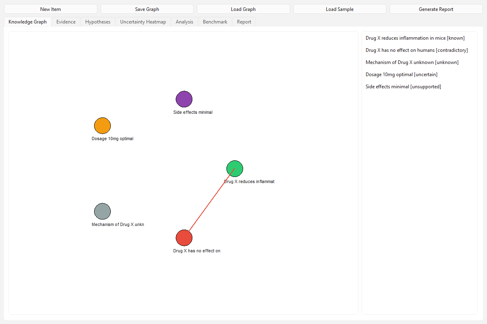
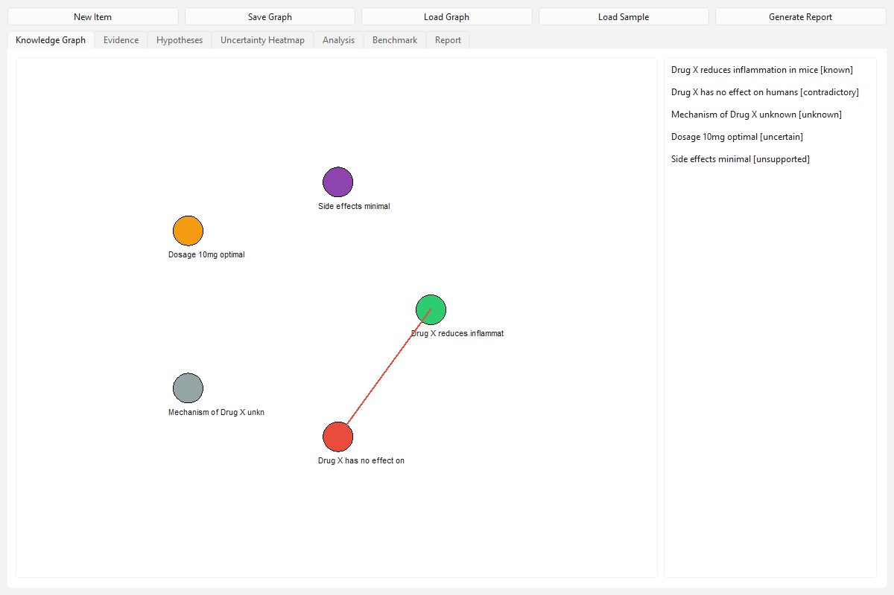
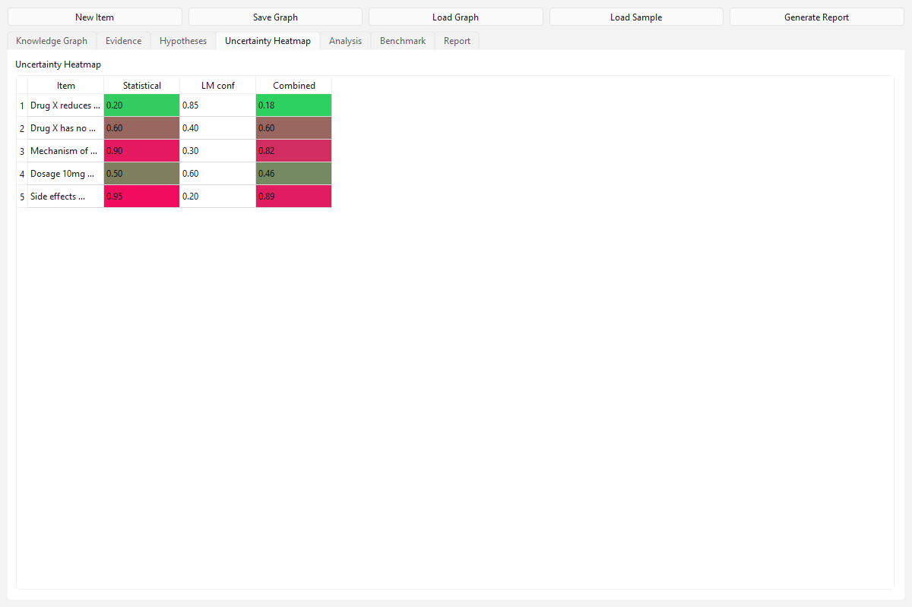
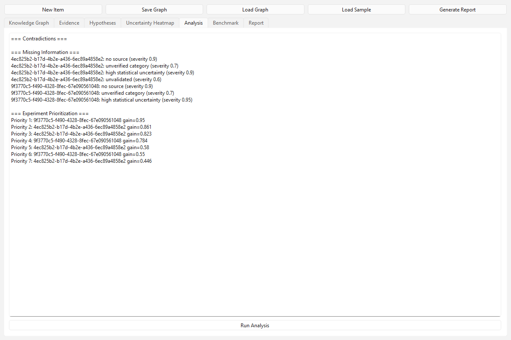

# Epistemic Engine

  

Experimental AI research platform that explicitly tracks what is **known, unknown, uncertain, contradictory, and unsupported**.

## Overview

Epistemic Engine models scientific knowledge as a graph where every item carries provenance, validation status, revision history, and separate statistical vs. subjective uncertainty. It detects contradictions, analyzes missing information, prioritizes experiments by expected information gain, and benchmarks uncertainty-aware research against baselines.

## Key features

- Scientific knowledge graph with typed edges (supports / contradicts / depends_on).
- Evidence provenance: every item has sources with reliability scores.
- Competing hypotheses with posterior updates.
- Contradiction detection (polarity mismatch on shared entities).
- Missing-information analysis.
- Experiment prioritization by expected information gain.
- Uncertainty heatmap distinguishing statistical uncertainty from LM confidence.
- PySide6 desktop interface with interactive graph, evidence inspection, hypothesis comparison, heatmap, analysis, benchmark, report.
- Benchmark: uncertainty-aware vs baseline hypothesis selection.
- SQLite persistence + JSON export.
- Windows EXE via PyInstaller.

## Installation

### From source
`
pip install -r requirements.txt  # or: pip install PySide6
python run.py
`

### Windows EXE
Download from [Releases](https://github.com/Nortaq-PlayNexus/epistemic-engine/releases).

## Quick start
1. Launch app.
2. Click "Load Sample".
3. Explore Knowledge Graph, Analysis, Heatmap tabs.
4. Click "Run Analysis" / "Run Benchmark".
5. "Generate Report" writes research_report.md.

## Architecture
See [docs/architecture.md](docs/architecture.md).

## Methodology
See [docs/methodology.md](docs/methodology.md).

## Testing
`
pytest -q
`

## Screenshots

## License
MIT
